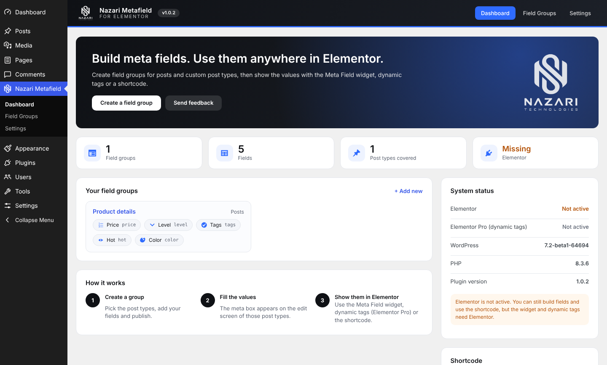
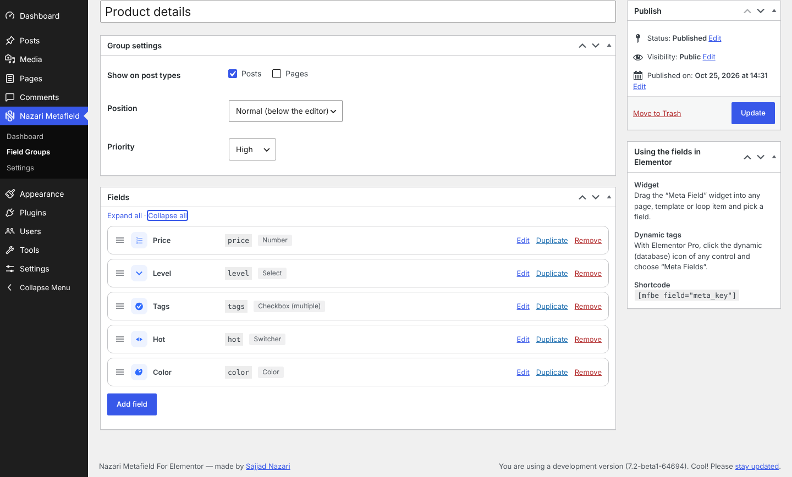
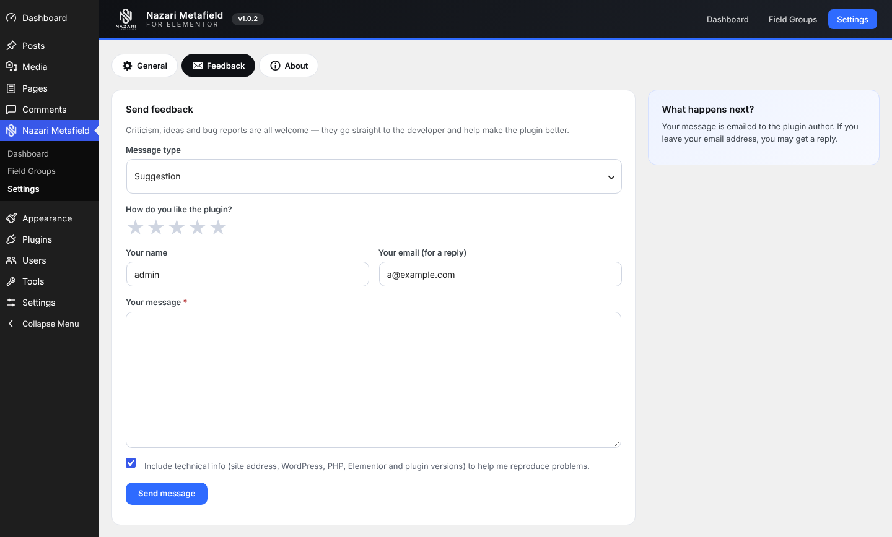

<p align="center">
  <picture>
    <source media="(prefers-color-scheme: dark)" srcset="assets/images/logo-white.png">
    
  </picture>
</p>

<h1 align="center">Nazari Metafield For Elementor</h1>

<p align="center">
  A lightweight, JetEngine-style meta box builder for WordPress, with first-class Elementor support.
</p>

<p align="center">
  
  
  
  
</p>

Create custom field groups for posts, pages and custom post types from a visual builder, then show the values anywhere in Elementor with a dedicated **Meta Field** widget, **dynamic tags** (Elementor Pro) or a **shortcode**.



## Features

- **Visual field group builder**: drag to reorder, duplicate fields, collapse/expand, copy each field's shortcode.
- **14 field types**: text, textarea, number, email, URL, select, radio, checkbox (multiple), switcher, date, color, WYSIWYG, image and gallery.
- **Meta boxes anywhere**: choose the post types, position (normal / side / advanced) and priority per group.
- **Elementor widget**: the *Meta Field* widget works with free Elementor and has controls for text before/after, fallback, "hide when empty", HTML tag, image size, gallery columns/gap, alignment, color and typography.
- **Dynamic tags** (Elementor Pro): Text, Number, URL, Color, Image and Gallery tags, grouped under "Meta Fields".
- **Shortcode**: `[mfbe field="meta_key"]` for everything else.
- **Plain post meta**: values are stored under the meta key you choose, so any other tool or theme can read them.
- **Branded admin area**: dashboard with stats and system status, settings, and a built-in feedback form.
- **Secure by default**: nonces and capability checks on every save, per-field sanitizing, and values of drafts, private and password-protected posts are never shown to visitors.
- **RTL ready** with a Persian (`fa_IR`) translation included.

## Screenshots

| Field group builder | Feedback form |
| --- | --- |
|  |  |

## Requirements

- WordPress 5.8 or newer
- PHP 7.4 or newer
- Elementor 3.6 or newer (optional for building fields and using the shortcode; required for the widget)
- Elementor Pro (optional; only needed for dynamic tags)

## Installation

1. Download the latest `nazari-metafield-for-elementor-x.y.z.zip` from the [Releases](../../releases) page.
2. In WordPress go to **Plugins > Add New > Upload Plugin**, choose the zip and activate it.
3. Open **Nazari Metafield** in the admin menu.

> Do not use GitHub's "Download ZIP" button for installing: it names the folder `…-main`. Use the zip attached to a release (see [Building a release](#building-a-release)).

### Upgrading from "Meta Fields for Elementor" 1.0.0

Just activate this plugin. The old one is deactivated automatically, and your field groups and saved values are kept.

## Usage

### 1. Create a field group

**Nazari Metafield > Field Groups > Add New**: pick the post types, add your fields and publish. Each field has a label, a meta key (lowercase letters, numbers, underscores), a width, an optional description, placeholder and default value, and options for select / radio / checkbox fields (one `value : label` per line).

### 2. Fill in the values

Edit any post of the chosen types. The meta box appears with your fields.

### 3. Show them in Elementor

**Widget**: drag **Meta Field** (category *Meta Fields*) onto the page, template or loop item, pick a field and style it.

**Dynamic tags** (Elementor Pro): click the dynamic (database) icon of any control and choose **Meta Fields**.

| Tag | Use it in |
| --- | --- |
| Meta Field (Text) | any text control (select/radio show the label, dates are formatted) |
| Meta Field (Number) | number controls |
| Meta Field (URL) | link controls (URL, email as `mailto:`, image file URL) |
| Meta Field (Color) | color controls |
| Meta Field (Image) | image controls, backgrounds |
| Meta Field (Gallery) | gallery, image carousel |

### Shortcode

```text
[mfbe field="price"]
[mfbe field="price" post_id="42" fallback="On request"]
[mfbe field="photos" size="medium" columns="4"]
[mfbe field="level" format="text"]
```

| Attribute | Default | Description |
| --- | --- | --- |
| `field` | (required) | The meta key of the field |
| `post_id` | current post | Read the value from another post |
| `format` | `html` | `html` or `text` |
| `size` | `full` | Image size for image and gallery fields |
| `columns` | `3` | Gallery columns |
| `fallback` | empty | Text shown when the field is empty |

### Reading the values from PHP

The values are normal post meta:

```php
$price = get_post_meta( get_the_ID(), 'price', true );
```

## Settings

**Nazari Metafield > Settings**

- **General**: optionally delete field groups and settings when the plugin is deleted (values saved on posts are always kept).
- **Feedback**: send criticism, ideas or bug reports to the author by email.
- **About**: version, changelog and author information.

## Project structure

```text
nazari-metafield-for-elementor/
├── nazari-metafield-for-elementor.php   # plugin header, bootstrap
├── uninstall.php
├── assets/                              # admin CSS/JS, logo
├── includes/
│   ├── class-mfbe-plugin.php            # loader
│   ├── class-mfbe-registry.php          # reads the saved field groups
│   ├── class-mfbe-fields.php            # field types: render / sanitize / output
│   ├── class-mfbe-groups.php            # field group post type + builder UI
│   ├── class-mfbe-metaboxes.php         # meta boxes on the edit screens
│   ├── class-mfbe-shortcode.php
│   ├── class-mfbe-admin.php             # menu, dashboard, settings, feedback
│   └── elementor/                       # widget and dynamic tags
└── languages/                           # fa_IR translation
```

## Building a release

The repository root is the plugin folder. To produce an installable zip whose top-level folder has the right name:

```bash
git tag v1.0.2
git archive --prefix=nazari-metafield-for-elementor/ \
  -o nazari-metafield-for-elementor-1.0.2.zip v1.0.2
```

Attach the zip to a GitHub Release. Files marked `export-ignore` in `.gitattributes` (screenshots, README, …) are left out of the zip.

## Roadmap

Ideas, not promises: repeater fields, conditional logic, relations between posts, a global options page. Open an issue if one of these matters to you.

## Feedback

Found a bug or have an idea? Open an [issue](../../issues), or use **Nazari Metafield > Settings > Feedback** inside WordPress.

## Changelog

### 1.0.2
- New name and branding (logo, top-level menu, branded admin screens).
- Dashboard with stats, field group overview and system status.
- Settings page: General, Feedback (emails the author), About.
- Field builder: type icons, duplicate field, expand/collapse all, copy shortcode.
- Optional "delete data on uninstall".
- Old "Meta Fields for Elementor" 1.0.0 is deactivated automatically.
- Persian (fa_IR) translation updated.

### 1.0.0
- First release: field groups, 14 field types, Elementor widget, dynamic tags and shortcode.

## Author

**Sajjad Nazari**, [sajjadnazari.com](https://sajjadnazari.com), [Nazari Technologies](https://sajjadnazari.com)

## License

The code is released under the [GPL-2.0-or-later](LICENSE).

The Nazari Technologies name and logo (`assets/images/`) are the author's brand assets and are not covered by the GPL; please do not reuse them to promote derived products.
